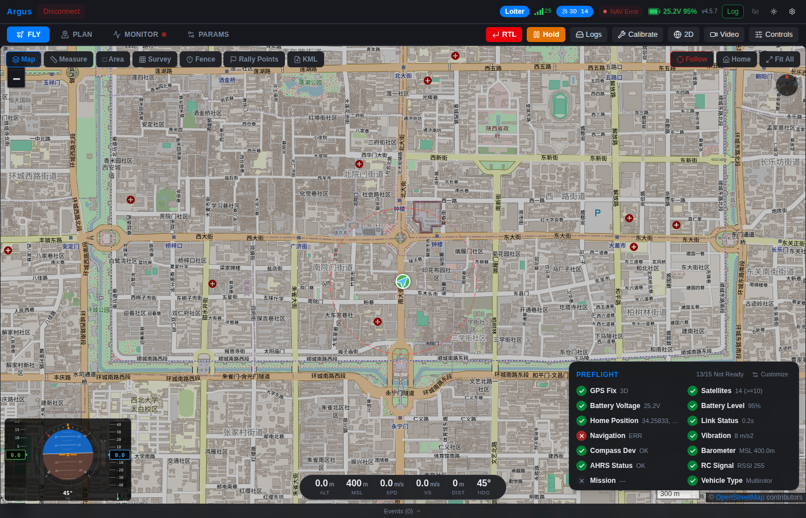

# Argus

[中文](README.zh.md) | **English**

> Web-based ground control station for ArduPilot vehicles.

[](https://github.com/L-X-Yao/argus/actions/workflows/ci.yml)

[](LICENSE)


<p align="center"></p>

## What & Why

Argus is a **web GCS** for ArduPilot: one browser interface on desktop, tablet and phone, in 10 languages. There is no hosted version: run the Python backend yourself, or install or unzip the Windows package (Python included), then open it in a browser.

> **Status**: ArduPilot is verified on ArduCopter SITL in CI and on a real flight controller on the bench, but Argus has not been through proper flight testing. [docs/VERIFICATION.md](docs/VERIFICATION.md) lists what has been tested and how, feature by feature. PX4 is not supported: a command for a PX4 vehicle is refused with an error.
>
> **Maintenance since November 2026**: bugs and security problems get fixed. Two pieces of new work were taken up since, at the maintainer's request: a Windows installer and operation by an AI assistant. See [Project Status](#project-status).

Why another GCS: Argus runs in a browser tab, so the device in your hand needs nothing installed, and it can reach a flight controller straight over USB (WebSerial).

| Existing GCS | How it differs |
|---|---|
| [QGroundControl](https://qgroundcontrol.com/) | A native application to install on each device |
| [Mission Planner](https://ardupilot.org/planner/) | A Windows application |
| Cloud platforms such as FlytBase | Closed source, tied to one vendor |

To fly real missions today, use QGroundControl or Mission Planner: both are flight proven and actively developed, and Argus is neither.

## Features

| Category | Features |
|---|---|
| **Connections** | TCP / UDP / Serial / WebSerial (browser-direct USB, no backend needed for telemetry + basic control) |
| **Protocols** | MAVLink v2, ArduPilot only (verified on SITL and on the bench, not flight-tested) |
| **Vehicles** | Copter, Plane, VTOL, Rover, Sub |
| **Map** | 8 tile sources (Amap, Google, OSM, Esri, CartoDB; Tianditu with a key of your own), each under [its own terms](#map-data) + 3D terrain (MapLibre GL) + offline mbtiles |
| **Mission** | WP / Spline / Loiter / Survey grid / Crosshatch / Spiral / Orbit + terrain profile with clearance check |
| **Formats** | Reads `.waypoints` (Mission Planner) and `.plan` (QGroundControl); reads and writes `.kml` and its own `.json` |
| **Parameters** | Metadata-driven UI (desc/range/units/enum/bitmask), tree view, diff export, default reset |
| **Calibration** | Compass, accel, gyro, level, baro wizards with real-time progress |
| **RTK** | NTRIP client with HTTP/1.0 + ICY-200 negotiation, streaming RTCM injection |
| **Firmware** | Store `.apj` files on the backend, online firmware browser, reboot to bootloader (no built-in flashing) |
| **Fleet** | Multi-vehicle dashboard with live telemetry per vehicle |
| **Video** | RTSP, HTTP and RTMP streams through ffmpeg on the backend, AR waypoint overlay, screenshot capture |
| **HUD** | PFD (attitude/speed/altitude/compass/wind), real-time charts, EKF status |
| **Audio** | Localized voice callouts (mode, battery, altitude, waypoints) in all 10 languages |
| **i18n** | 10 languages (zh, en, ja, ko, de, fr, es, pt, ru, ar) + RTL |
| **Offline** | PWA with service worker, mbtiles support, tile caching (5000 tiles, the oldest dropped first) |
| **Desktop** | A Windows installer: for your account only, without administrator rights, with Start menu shortcuts and an uninstaller. It installs the program the zip holds, which opens in your browser. The Tauri v2 config in `src-tauri/` has never been built and is not used |
| **AI assistant** | An MCP server for AI clients such as Claude Desktop or Claude Code: it reads what the page shows and proposes missions, parameter changes, and return, hold or land in flight, which the operator approves in the page |
| **Security** | Token auth, cross-site and DNS-rebinding request blocking, SSRF + path-traversal guards, statustext filtering |

## Install

### Windows package

For Windows 10 and 11, x64. Python and every library come with Argus. A release offers two downloads that hold the same program:

- `Argus_GCS_vX.Y.Z_amd64_setup.exe`, an installer. It installs for your account only, without administrator rights, into `%LOCALAPPDATA%\Programs\Argus GCS` by default; any empty folder, or an earlier Argus folder, can be chosen instead. It adds Start menu shortcuts and an uninstaller.
- `Argus_GCS_vX.Y.Z_amd64.zip`, which installs nothing: unzip it anywhere.

1. Download one of them and `SHA256SUMS.txt` from the [latest release](https://github.com/L-X-Yao/argus/releases/latest).
2. Check the download, because neither is code-signed. For the same reason Windows may warn that the publisher is unknown.

   ```powershell
   $file = 'Argus_GCS_vX.Y.Z_amd64_setup.exe'   # or the .zip
   $want = (@(Get-Content SHA256SUMS.txt) -match [regex]::Escape($file)).Split(' ')[0]
   (Get-FileHash $file -Algorithm SHA256).Hash -eq $want   # True when the download is intact
   gh attestation verify $file --repo L-X-Yao/argus      # optional, needs the GitHub CLI, signed in
   ```

3. Start Argus from the Start menu ("Argus Ground Station"), or double-click `Argus地面站.bat` ("Argus ground station") in the unzipped folder. A browser opens `http://localhost:8100`.

The simulator shortcut, or `启动仿真器.bat` ("start simulator"), starts the built-in simulator. `README.txt` beside the program repeats these steps.

Uninstalling removes the program, its caches and its access token. It keeps the flight logs (`logs`), your own map files (`mbtiles`) and firmware files (`firmware`) in the install folder. Close Argus before you uninstall it: the uninstaller does not check.

### From source

For Linux, macOS and Windows. Needs Python 3.11 or newer and Node.js. CI runs on Node 24 and Python 3.14, which is also the Python the Windows package bundles. Video needs `ffmpeg` on the PATH.

```bash
git clone https://github.com/L-X-Yao/argus && cd argus
npm install && npm run build   # the web interface, into dist/
pip install -e .               # the backend and its dependencies
python run.py                  # serves everything at http://127.0.0.1:8100
```

## Connect

Argus listens on this machine only. To reach it from another device, read [SECURITY.md](SECURITY.md) first: that needs a token. [From a phone or tablet](#from-a-phone-or-tablet) has the steps.

### Real hardware

Plug the flight controller in, open `http://127.0.0.1:8100`, and pick the serial port from the dropdown. A network link takes an address instead, such as `tcp:192.168.1.10:5760` or `udp:14550`.

### ArduPilot SITL

```bash
sim_vehicle.py -v ArduCopter --out=udp:127.0.0.1:14550
python run.py
# Open the UI, click the "SITL" quick-connect button
```

### Built-in simulator (no FC, no SITL)

```bash
python run.py --sim            # Starts backend + simulator.py together
# Connect to "tcp:localhost:5770"
```

The simulator (`scripts/simulator.py`) emits realistic telemetry (GPS, attitude, battery drain, heartbeat) and responds to arm/disarm/mode commands.

### WebSerial (direct USB)

Open Argus in Chrome/Edge, click the **USB** button, pick your flight controller. Telemetry, arm/disarm/mode/RTL, param read+write, mission upload/download/clear, fence upload, log list/download, and all 5 calibration types flow directly via WebSerial and the built-in TypeScript MAVLink v2 codec. Map tiles, terrain profiles, parameter descriptions, video, and firmware file storage still use the Python backend; without it, new map tiles cannot load. RTK (NTRIP) and the MAVLink console need the FC connected through the backend, so they are unavailable over WebSerial.

### From a phone or tablet

There is no app. A phone or tablet is a second screen: Argus runs on a computer, the flight controller stays connected to that computer, and the browser on the phone opens the computer's address.

1. Start Argus with a token and on the network. For a computer at `192.168.1.5`:

   ```bash
   # from source
   GCS_AUTH_TOKEN=change-me-to-a-long-random-value \
   ARGUS_CORS_ORIGINS=http://localhost:8100,http://127.0.0.1:8100,http://192.168.1.5:8100 \
     python run.py --host 0.0.0.0
   ```

   ```bat
   :: Windows package, in a command prompt opened in its folder
   set GCS_AUTH_TOKEN=change-me-to-a-long-random-value
   set ARGUS_CORS_ORIGINS=http://localhost:8100,http://127.0.0.1:8100,http://192.168.1.5:8100
   python\python.exe backend\server.py --host 0.0.0.0
   ```

   At start, Argus prints the address it expects the other device to open and, when `ARGUS_CORS_ORIGINS` leaves it out, the value to set. A page opened at an address that is not listed still loads, and its login is refused with the address to add. With a hotspot this computer provides, a VPN or a second network card, the phone may reach the computer at another address than the one printed. Windows may ask whether Python may accept connections.

2. On the phone, open `http://192.168.1.5:8100` and type the token.

What to expect:

- On a screen narrower than 768 px, such as a phone held upright, the four views (Fly, Plan, Monitor, Params) are tabs at the bottom. While a vehicle is connected, RTL and hold sit above them, and in the Fly view the button for the flight controls (arming, modes) too. Logs, calibration, the 2D/3D switch and video are in the wide layout only. Most phones turned on their side are wider than 768 px and get the desktop layout, with everything in it, on a small screen.
- The browser that connected first commands the vehicle, and later ones watch. Close the page on the computer if the phone is to command.
- USB from the phone (WebSerial) and offline use need `https` or `localhost`, so they do not work at a plain `http` network address.
- The link is plain HTTP: the token and every command can be read on the way. Use a network you trust, and read [SECURITY.md](SECURITY.md).

This was checked in a phone-sized touch browser on a network address (2026-11-11), not on a real phone.

### AI assistant (MCP)

An AI client that speaks the [Model Context Protocol](https://modelcontextprotocol.io), such as Claude Desktop or Claude Code, can read Argus and propose changes to it. Each change waits in the Argus page, where the operator approves or declines it, and in the Fly and Plan views the route of a proposed mission is drawn dashed on the map meanwhile.

| Tool | What it does |
|---|---|
| `get_status` | What the page shows about the vehicle: link, mode, armed, position, altitudes, speeds, battery, GPS, home, recent messages |
| `get_mission` | The mission planned in the page |
| `get_parameters` | Parameter values the page has read, by name or prefix |
| `propose_mission` | A mission for the operator, shown waypoint by waypoint with every speed, hold and circling: uploaded only if approved |
| `propose_parameters` | Parameter changes for the operator, with old and new values: written only if approved |
| `propose_flight_command` | Return to launch, hold or land, for a vehicle that is armed: sent only if approved and then confirmed with a slide, as the RTL button is |
| `check_proposal` | Whether the operator has decided, and the result |
| `withdraw_proposal` | Takes back a proposal not yet decided |

A proposal returns its id at once, and `check_proposal` waits up to 50 s a call for the decision, so the operator can take minutes. A mission or parameter change is refused while the vehicle is armed, and a flight command while it is not. The tools cannot arm, take off, start a mission or change to any other mode.

These limits are those of the tools. A client that can also run commands on this computer, as Claude Code can, could reach Argus and the vehicle in other ways, as any program here could: keep it asking before each command, which is its default.

Set it up with Argus running and its page open, which answers for the vehicle:

- Claude Code, after `pip install -e .` in this repository: `claude mcp add argus -- argus-mcp`
- Claude Desktop, in `claude_desktop_config.json`, with the Python of the Windows package:

  ```json
  {"mcpServers": {"argus": {"command": "C:\\path\\to\\Argus\\python\\python.exe", "args": ["-m", "backend.mcp_server"]}}}
  ```

The server reaches Argus at `ARGUS_URL` (`http://127.0.0.1:8100` when unset). When Argus has a token, the server uses the one generated in the page for this install, or else `GCS_AUTH_TOKEN`: give that one to Claude Code with `claude mcp add argus -e GCS_AUTH_TOKEN=<token> -- argus-mcp`, and to Claude Desktop with `"env": {"GCS_AUTH_TOKEN": "<token>"}` beside `"args"`. The page shows "AI" in the status bar while an assistant is connected. What the tools return, positions and parameters included, goes to the AI client and its provider.

### Map data

Map tiles, terrain heights and ArduPilot's firmware and parameter lists are not part of Argus. Argus fetches them from other parties' servers when you use the feature, under the terms of each server: [THIRD_PARTY_NOTICES.md](THIRD_PARTY_NOTICES.md) lists them.

- The map shows the credit of the server it comes from. The backend names itself to the servers it asks (`Argus-GCS/<version>`). The terrain of the 3D view is read by the browser itself.
- The AutoNavi (Amap) source, which is the default, and the Google sources are not published APIs: they are the addresses those companies' own web maps read. Choose another source in Settings if that matters to you.
- OpenStreetMap forbids bulk download from its tile server, so the Offline Maps panel does not offer it. A map file of your own (`.mbtiles` in `mbtiles/`) works without any server.

## Architecture

```
+------------------------------------------+
|  Browser (Svelte 5 + TypeScript 6)       |
|  80 components, 27K lines                |
|  MAVLink v2 codec (pure TS)              |
|  WebSerial direct USB connection         |
|  41 lazy-loaded panels + view splitting  |
+------------------------------------------+
|          WebSocket (JSON delta push)     |
+------------------------------------------+
|  Python Backend (FastAPI + uvicorn)      |
|  31 modules, 7.1K lines                  |
|  MAVLink dispatch + 35 message handlers  |
|  53 commands, tile/video/firmware API    |
+------------------------------------------+
|          MAVLink v2                      |
|  TCP / UDP / Serial                      |
+------------------------------------------+
|  Flight Controller (ArduPilot)           |
+------------------------------------------+
```

### Key modules

| Module | Description |
|---|---|
| `src/lib/mavlink/` | Pure TypeScript MAVLink v2 encoder/decoder with CRC validation |
| `src/lib/fc/` | Flight controller adapter with ArduPilot and PX4 mode tables. Only its own tests use it: the app does not import it |
| `src/lib/transport.ts` | Dual-mode transport (WebSocket backend vs WebSerial direct) |
| `src/lib/serial.ts` | Web Serial API wrapper with FC USB vendor filters |
| `src/lib/terrain.ts` | SRTM elevation queries for terrain-following missions |
| `src/lib/missionIO.ts` | Mission import/export (`.waypoints` / `.plan` / `.kml`), and the checks on what a file or browser storage holds |
| `src/lib/survey.ts` | Survey patterns (grid, crosshatch, spiral, orbit) |
| `src/lib/i18n.svelte.ts` | 10-language i18n with RTL support |
| `backend/drone_link.py` | MAVLink connection, frame parsing, state management |
| `backend/commands/` | 53 command handlers (arm, mode, mission, calibration, gimbal, NTRIP, etc.) |
| `backend/config.py` | Centralized configuration (all timeouts/ports/rates) |

## Development

Install the development tools with `pip install -e '.[dev]'`. `npm run dev` serves the interface at `http://127.0.0.1:5173` with hot reload and passes API calls on to a backend started with `python run.py`.

> **Windows / recent Node note**: Node ≥17 may resolve `localhost` to IPv6 `::1`, while the backend binds IPv4-only `127.0.0.1` — use `127.0.0.1` in dev URLs.

```bash
# Backend unit + contract tests
python -m pytest tests/test_unit_*.py tests/test_contract_*.py -v

# Frontend unit tests
npx vitest run

# Type check (must be 0 errors, 0 warnings)
npx svelte-check --tsconfig ./tsconfig.json

# Python lint
ruff check backend/ scripts/ tests/

# Formatting (npm run format fixes it)
npm run format:check

# Integration tests (start their own backend and simulator)
make test-integration

# Production build
npm run build

# E2E (needs the production build; starts its own backend)
npm run test:e2e -- --project=chromium
```

**Git hooks** (enable once per clone with `git config core.hooksPath .githooks`):
- **pre-commit**: ruff + svelte-check
- **pre-push**: vitest + pytest unit and contract tests

**Deeper docs**:

- [`CONTRIBUTING.md`](CONTRIBUTING.md) — development rules: CI limits, both links, tests, review, releases
- [`CLAUDE.md`](CLAUDE.md) — project conventions, PX4 status, protocol-coupling discipline
- [`docs/VERIFICATION.md`](docs/VERIFICATION.md) — how far every feature has been verified
- [`SECURITY.md`](SECURITY.md) — how to run it safely, and how to report a vulnerability
- [`THIRD_PARTY_NOTICES.md`](THIRD_PARTY_NOTICES.md) — work of others in the repository and the package, and the servers Argus reads
- [`docs/FEATURE_CHECKLIST.md`](docs/FEATURE_CHECKLIST.md) — feature snapshot from v3.4, frozen
- [`docs/protocol_design.md`](docs/protocol_design.md) — load-bearing design decisions
- [`docs/audits/`](docs/audits/) — archived audit reports

## Release

```bash
bash scripts/make-release.sh X.Y.Z
```

This command bumps the version everywhere it is stored, runs the frontend, unit and contract tests, commits, tags, and pushes. GitHub Actions then runs every CI check on the tagged commit, builds the Windows package and from it the installer, starts both on Windows, and only if all of that passes publishes a GitHub Release with both, their checksums and a changelog. The Windows package is also checked by hand before and after: see [CONTRIBUTING.md](CONTRIBUTING.md#releases).

Alternatively, to generate a changelog preview locally:

```bash
bash scripts/changelog.sh v3.5.0   # Changes since v3.5.0
```

## Project Status

Argus is in maintenance since November 2026: bugs and security problems get fixed. Two pieces of new work were taken up since, at the maintainer's request: a Windows installer, and operation by an AI assistant through MCP, in which every change waits for the operator's approval in the page. The assistant reads the page and proposes missions, parameter changes, and return, hold or land; arming, takeoff and starting a mission are not open to it.

**Built**

- Rally points: map editing, upload and clear on both links
- Terrain profile panel with clearance visualization
- In-flight waypoint jump (MISSION_SET_CURRENT)
- WebSerial mission upload/download/clear + fence upload
- WebSerial log list + binary download
- WebSerial all 5 calibration types (compass, accel, gyro, level, baro)
- 3D map waypoint editing, fence drawing, distance/area measure
- NTRIP RTK client (HTTP/1.0 + ICY-200, RTCM streaming)
- Compass/accel/gyro calibration with binary progress
- Multi-language UI (10 locales + RTL)
- Dual-transport mutex (WS backend / WebSerial)
- Gimbal pitch/yaw control
- Tag-triggered release workflow with auto-changelog
- Windows installer for your account only, without administrator rights
- AI assistant through MCP: reads the page, proposes missions, parameter changes, and return, hold or land, and the operator approves each

**No longer planned**

These were on the roadmap and will not be built here:

- Firmware flashing (APJ parsing + bootloader protocol)
- PX4 end-to-end support (the backend reads `HEARTBEAT.autopilot` and refuses PX4; the frontend holds a mode table only)
- WebRTC video streaming (replace the ffmpeg proxy)
- MQTT cloud relay for fleet management
- MAVLink FTP for firmware upload and Lua script management
- MSP protocol support (BetaFlight / iNav)

What Argus does not do, and what has never been tested, is listed in [docs/VERIFICATION.md](docs/VERIFICATION.md) and [SECURITY.md](SECURITY.md).

## Contributing

Bug reports and fixes are welcome. A feature request is unlikely to be picked up: see [Project Status](#project-status). Before sending a PR:

1. Tests pass locally: `npx vitest run && python -m pytest tests/test_unit_*.py tests/test_contract_*.py`
2. Type check is clean: `npx svelte-check` (0 errors, 0 warnings)
3. Python lint is clean: `ruff check backend/ scripts/ tests/`
4. Formatting is clean: `npm run format:check`
5. Commit convention: `<type>: <imperative description>` (types: `feat`, `fix`, `perf`, `refactor`, `test`, `docs`, `ci`, `chore`)
6. For FC-coupled code (MAVLink commands, ACK handling, calibration), cite upstream ArduPilot/PX4 source `file:line` in a comment — see `CLAUDE.md ## Protocol Code Discipline`

## Acknowledgments

Argus stands on the shoulders of:

- [ArduPilot](https://ardupilot.org/) — the flight controller firmware that defines the protocol semantics this GCS targets
- [pymavlink](https://github.com/ArduPilot/pymavlink) — reference MAVLink codec used to validate our pure-TS implementation
- [MAVLink](https://mavlink.io/) — the messaging protocol itself
- [Svelte](https://svelte.dev/), [FastAPI](https://fastapi.tiangolo.com/), [Leaflet](https://leafletjs.com/), [MapLibre GL](https://maplibre.org/), [Tauri](https://tauri.app/) — the application stack
- [QGroundControl](https://github.com/mavlink/qgroundcontrol) — the six calibration pictures come from it (Apache-2.0)
- QGroundControl, Mission Planner, MAVProxy — for showing what's possible

## License

MIT — see [LICENSE](LICENSE). Work of others in the repository and in the Windows package keeps its own license: see [THIRD_PARTY_NOTICES.md](THIRD_PARTY_NOTICES.md).
