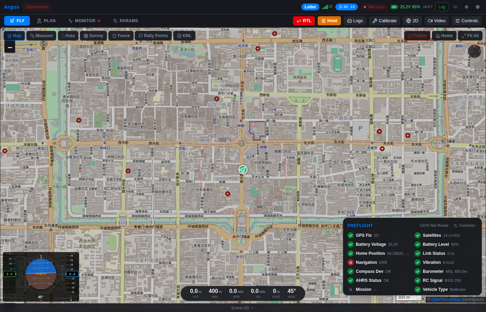

# Argus

**中文** | [English](README.md)

> ArduPilot 无人机的 Web 地面站。

[](https://github.com/L-X-Yao/argus/actions/workflows/ci.yml)

[](LICENSE)


<p align="center"></p>

## 定位

Argus 是面向 ArduPilot 的 **Web 地面站**：一个浏览器界面，支持桌面、平板和手机，内置 10 种语言。没有托管版本：自己运行 Python 后端，或安装、解压 Windows 发布包（已内置 Python），再用浏览器打开。

> **当前状态**：ArduPilot 已通过 CI 中的 ArduCopter SITL 和真实飞控台架验证，尚未经过正式飞行测试。每项功能验证到什么程度，见 [docs/VERIFICATION.md](docs/VERIFICATION.md)。不支持 PX4：发给 PX4 飞控的命令会被拒绝并报错。
>
> **2026 年 11 月起进入维护阶段**：修复缺陷和安全问题。此后应维护者要求新增了两项工作：Windows 安装程序，以及由 AI 助手操作。见[项目状态](#项目状态)。

为什么还需要一个 GCS：Argus 运行在浏览器标签页里，手上的设备不用安装任何东西，还能通过 USB 直连飞控（WebSerial）。

| 现有 GCS | 区别 |
|---|---|
| [QGroundControl](https://qgroundcontrol.com/) | 原生应用，每台设备都要安装 |
| [Mission Planner](https://ardupilot.org/planner/) | Windows 应用 |
| FlytBase 等云平台 | 闭源，绑定单一厂商 |

现在要执行真实飞行任务，请用 QGroundControl 或 Mission Planner：两者都经过飞行验证并在持续开发，Argus 两样都不具备。

## 功能一览

| 分类 | 功能 |
|---|---|
| **连接** | TCP / UDP / Serial / WebSerial（浏览器直连 USB，遥测和基础控制无需后端） |
| **协议** | MAVLink v2，仅 ArduPilot（已做 SITL 和台架验证，未正式试飞） |
| **机型** | 多旋翼、固定翼、VTOL、地面车、水下潜航器 |
| **地图** | 8 种图源（高德、Google、OSM、Esri、CartoDB；天地图需自备密钥），各自受[其服务条款](#地图数据)约束 + 3D 地形（MapLibre GL）+ 离线 mbtiles |
| **航线** | 航点 / 曲线 / 盘旋 / 测绘网格 / 交叉 / 螺旋 / 环绕 + 地形剖面与净空检查 |
| **格式** | 读取 `.waypoints`（Mission Planner）和 `.plan`（QGroundControl）；读写 `.kml` 和自有的 `.json` |
| **参数** | 元数据驱动 UI（描述/范围/单位/枚举/位掩码），树形视图，差异导出，恢复默认 |
| **校准** | 罗盘、加速度计、陀螺仪、水平、气压计向导，实时进度 |
| **RTK** | NTRIP 客户端，HTTP/1.0 + ICY-200 协商，RTCM 流式注入 |
| **固件** | 在后端保存 `.apj` 文件，在线固件浏览器，重启至 Bootloader（不含刷写功能） |
| **编队** | 多机仪表盘，每架飞机实时遥测 |
| **视频** | 后端经 ffmpeg 转发 RTSP、HTTP 和 RTMP 视频流，AR 航点叠加，截图 |
| **HUD** | PFD（姿态/速度/高度/罗盘/风向），实时图表，EKF 状态 |
| **语音** | 10 语言本地化语音播报（模式、电量、高度、航点） |
| **多语言** | 10 种语言（中/英/日/韩/德/法/西/葡/俄/阿）+ RTL |
| **离线** | PWA + Service Worker，mbtiles 支持，瓦片缓存（5000 张，先存的先清） |
| **桌面** | Windows 安装程序：只为当前用户安装，不需要管理员权限，带开始菜单快捷方式和卸载程序。装的是 zip 里的同一个程序，在浏览器里打开。`src-tauri/` 里的 Tauri v2 配置从未构建过，也不使用 |
| **AI 助手** | 为 Claude Desktop、Claude Code 等 AI 客户端提供的 MCP 服务：读取页面显示的内容，提出航线、参数修改，以及飞行中的返航、悬停或降落，由操作员在页面上批准 |
| **安全** | Token 认证，跨站与 DNS 重绑定请求拦截，SSRF + 路径穿越防护，statustext 过滤 |

## 安装

### Windows 发布包

适用于 Windows 10 和 11（x64）。Python 和所有依赖库都随 Argus 提供。每个版本有两个下载，里面是同一个程序：

- `Argus_GCS_vX.Y.Z_amd64_setup.exe`：安装程序。只为当前用户安装，不需要管理员权限，装到 `%LOCALAPPDATA%\Programs\Argus GCS`，带开始菜单快捷方式和卸载程序。
- `Argus_GCS_vX.Y.Z_amd64.zip`：不安装任何东西，解压到任意位置即可。

1. 从[最新发布](https://github.com/L-X-Yao/argus/releases/latest)下载其中一个，以及 `SHA256SUMS.txt`。
2. 校验下载的文件，因为两者都没有代码签名。也因为这个原因，Windows 可能提示发布者未知。

   ```powershell
   $file = 'Argus_GCS_vX.Y.Z_amd64_setup.exe'   # 或者 .zip
   $want = (@(Get-Content SHA256SUMS.txt) -match [regex]::Escape($file)).Split(' ')[0]
   (Get-FileHash $file -Algorithm SHA256).Hash -eq $want   # 文件完好时输出 True
   gh attestation verify $file --repo L-X-Yao/argus      # 可选，需要已登录的 GitHub CLI
   ```

3. 从开始菜单启动（“Argus 地面站”），或在解压出的文件夹里双击 `Argus地面站.bat`，浏览器会打开 `http://localhost:8100`。

仿真器快捷方式或 `启动仿真器.bat` 启动内置模拟器。程序旁边的 `README.txt` 写有同样的步骤。

卸载会删除程序、缓存和访问令牌，保留安装文件夹里的飞行日志（`logs`）、你自己的地图文件（`mbtiles`）和固件文件（`firmware`）。卸载前先关闭 Argus：卸载程序不会检查它是否在运行。

### 从源码运行

适用于 Linux、macOS 和 Windows。需要 Python 3.11 或更高版本，以及 Node.js。CI 运行在 Node 24 和 Python 3.14 上，Windows 发布包内置的也是 Python 3.14。视频功能需要 PATH 里有 `ffmpeg`。

```bash
git clone https://github.com/L-X-Yao/argus && cd argus
npm install && npm run build   # 构建 Web 界面到 dist/
pip install -e .               # 后端及其依赖
python run.py                  # 在 http://127.0.0.1:8100 提供全部服务
```

## 连接

Argus 只监听本机。要从其他设备访问，先读 [SECURITY.md](SECURITY.md)：那需要设置令牌。步骤见[从手机或平板打开](#从手机或平板打开)。

### 真实硬件

插上飞控，打开 `http://127.0.0.1:8100`，从下拉框选择串口。网络链路则填地址，例如 `tcp:192.168.1.10:5760` 或 `udp:14550`。

### ArduPilot SITL

```bash
sim_vehicle.py -v ArduCopter --out=udp:127.0.0.1:14550
python run.py
# 打开 UI，点击 "SITL" 快速连接按钮
```

### 内置 MAVLink 模拟器（无需飞控、无需 SITL）

```bash
python run.py --sim            # 同时启动后端 + simulator.py
# 连接到 "tcp:localhost:5770"
```

模拟器（`scripts/simulator.py`）发送仿真遥测数据（GPS、姿态、电量消耗、心跳），响应解锁/锁定/模式切换命令。

### WebSerial（USB 直连）

用 Chrome/Edge 打开 Argus，点击 **USB** 按钮，选择飞控。遥测、解锁/锁定/模式/RTL、参数读写、航线上传/下载/清除、围栏上传、日志列表/下载、全部 5 种校准类型均通过 WebSerial 和内置 TypeScript MAVLink v2 编解码器直连。地图瓦片、地形剖面、参数说明、视频和固件文件存储仍依赖 Python 后端，没有后端时新的地图瓦片无法加载。RTK（NTRIP）和 MAVLink 控制台需要飞控通过后端连接，WebSerial 直连时不可用。

### 从手机或平板打开

没有 APP。手机或平板只是第二块屏幕：Argus 运行在电脑上，飞控接在这台电脑上，手机浏览器打开电脑的地址。

1. 带令牌启动 Argus，并让它监听局域网。以电脑地址 `192.168.1.5` 为例：

   ```bash
   # 从源码运行
   GCS_AUTH_TOKEN=change-me-to-a-long-random-value \
   ARGUS_CORS_ORIGINS=http://localhost:8100,http://127.0.0.1:8100,http://192.168.1.5:8100 \
     python run.py --host 0.0.0.0
   ```

   ```bat
   :: Windows 发布包，在它的文件夹里打开命令提示符
   set GCS_AUTH_TOKEN=change-me-to-a-long-random-value
   set ARGUS_CORS_ORIGINS=http://localhost:8100,http://127.0.0.1:8100,http://192.168.1.5:8100
   python\python.exe backend\server.py --host 0.0.0.0
   ```

   启动时，Argus 会打印它估计其他设备该打开的地址；`ARGUS_CORS_ORIGINS` 里没有这个地址时，还会打印应设置的值。从未列出的地址打开的页面照样能加载，但登录会被拒绝，并提示要添加的地址。如果这台电脑开着热点、连着 VPN 或有第二块网卡，手机访问它的地址可能和打印的不同。Windows 可能会询问是否允许 Python 接受连接。

2. 在手机上打开 `http://192.168.1.5:8100`，输入令牌。

实际效果：

- 屏幕宽度小于 768 px 时（例如竖着拿的手机），飞行、规划、监控、参数四个视图是底部的标签。连上飞行器后，标签上方有返航和悬停按钮，飞行视图里还有飞行操控（解锁、切换模式）按钮。日志、校准、2D/3D 切换和视频只在宽屏布局里有。多数手机横过来宽于 768 px，会变成电脑版布局，功能齐全，只是屏幕小。
- 最先连上的浏览器指挥飞行器，后连上的只能观看。要让手机指挥，先关掉电脑上的页面。
- 手机直接接 USB（WebSerial）和离线使用需要 `https` 或 `localhost`，在普通的 `http` 局域网地址上不可用。
- 链路是明文 HTTP：令牌和每条指令在途中都能被读到。只在信任的网络里使用，并阅读 [SECURITY.md](SECURITY.md)。

以上在局域网地址上用手机尺寸的触屏浏览器检查过（2026-11-11），没有在真实手机上检查过。

### AI 助手（MCP）

支持 [Model Context Protocol](https://modelcontextprotocol.io) 的 AI 客户端（例如 Claude Desktop、Claude Code）可以读取 Argus 并提出修改。每项修改都在 Argus 页面上等待，由操作员批准或拒绝；等待期间，在飞行和规划视图里，提议的航线以虚线画在地图上。

| 工具 | 作用 |
|---|---|
| `get_status` | 页面显示的飞行器状态：链路、模式、是否解锁、位置、高度、速度、电池、GPS、家点、最近消息 |
| `get_mission` | 页面上的计划航线 |
| `get_parameters` | 页面已读取的参数值，按名称或前缀 |
| `propose_mission` | 提交给操作员的航线，逐个航点显示速度、停留和盘旋：批准后才上传 |
| `propose_parameters` | 提交给操作员的参数修改，显示原值和新值：批准后才写入 |
| `propose_flight_command` | 返航、悬停或降落，只用于已解锁的飞行器：批准后还要像返航按钮一样滑动确认，才会发送 |
| `check_proposal` | 操作员是否已决定，以及执行结果 |
| `withdraw_proposal` | 撤回尚未决定的提议 |

提议会立即返回编号，`check_proposal` 每次最多等 50 秒，所以操作员可以花几分钟再决定。飞行器解锁时拒绝航线和参数修改，未解锁时拒绝飞行指令。这些工具不能解锁、起飞、开始任务，也不能切换到其他模式。

以上限制只针对这些工具。能在本机执行命令的客户端（例如 Claude Code）也能像本机任何程序一样，通过别的途径访问 Argus 和飞行器：请保持它每次执行命令前都先询问（这是它的默认设置）。

配置时 Argus 要在运行，且页面要打开（由页面应答飞行器的状态）：

- Claude Code：在本仓库 `pip install -e .` 之后执行 `claude mcp add argus -- argus-mcp`
- Claude Desktop：在 `claude_desktop_config.json` 里使用 Windows 发布包自带的 Python：

  ```json
  {"mcpServers": {"argus": {"command": "C:\\path\\to\\Argus\\python\\python.exe", "args": ["-m", "backend.mcp_server"]}}}
  ```

服务通过 `ARGUS_URL`（未设置时为 `http://127.0.0.1:8100`）连接 Argus。Argus 设了令牌时，服务使用本安装在页面上生成的令牌，否则使用 `GCS_AUTH_TOKEN`：Claude Code 用 `claude mcp add argus -e GCS_AUTH_TOKEN=<令牌> -- argus-mcp` 传入，Claude Desktop 在 `"args"` 旁加 `"env": {"GCS_AUTH_TOKEN": "<令牌>"}`。连接期间页面状态栏显示 “AI”。工具返回的内容（包括位置和参数）会交给 AI 客户端及其服务商。

### 地图数据

地图瓦片、地形高程以及 ArduPilot 的固件和参数列表都不属于 Argus。使用相应功能时，Argus 从第三方服务器获取这些数据，并受各服务器条款约束，清单见 [THIRD_PARTY_NOTICES.md](THIRD_PARTY_NOTICES.md)。

- 地图上会显示图源的署名。后端向它请求的服务器表明自己的身份（`Argus-GCS/<版本号>`）。3D 视图的地形由浏览器直接读取。
- 默认的高德图源和 Google 图源都不是公开发布的 API，而是这两家公司自己的网页地图读取的地址。介意的话请在设置里换用其他图源。
- OpenStreetMap 禁止从它的瓦片服务器批量下载，所以离线地图面板不提供这一项。自备的地图文件（放在 `mbtiles/` 下的 `.mbtiles`）不依赖任何服务器。

## 架构

```
+------------------------------------------+
|  浏览器 (Svelte 5 + TypeScript 6)        |
|  80 组件, 27K 行                          |
|  MAVLink v2 编解码器 (纯 TS)              |
|  WebSerial 直连 USB                       |
|  41 个懒加载面板 + 视图分割               |
+------------------------------------------+
|          WebSocket (JSON 增量推送)        |
+------------------------------------------+
|  Python 后端 (FastAPI + uvicorn)          |
|  31 模块, 7.1K 行                        |
|  MAVLink 分发 + 35 消息处理器             |
|  53 条命令, 瓦片/视频/固件 API            |
+------------------------------------------+
|          MAVLink v2                       |
|  TCP / UDP / Serial                      |
+------------------------------------------+
|  飞控 (ArduPilot)                         |
+------------------------------------------+
```

### 核心模块

| 模块 | 说明 |
|---|---|
| `src/lib/mavlink/` | 纯 TypeScript MAVLink v2 编解码器，含 CRC 校验 |
| `src/lib/fc/` | 飞控适配器，含 ArduPilot 和 PX4 模式表。只有它自己的测试在用：应用没有引入它 |
| `src/lib/transport.ts` | 双模式传输（WebSocket 后端 / WebSerial 直连） |
| `src/lib/serial.ts` | Web Serial API 封装，含飞控 USB 厂商过滤器 |
| `src/lib/terrain.ts` | SRTM 高程查询，用于地形跟随航线 |
| `src/lib/missionIO.ts` | 航线导入导出（`.waypoints` / `.plan` / `.kml`），以及对文件和浏览器存储内容的检查 |
| `src/lib/survey.ts` | 测绘图案生成（网格、交叉、螺旋、环绕） |
| `src/lib/i18n.svelte.ts` | 10 语言国际化，支持 RTL |
| `backend/drone_link.py` | MAVLink 连接、帧解析、状态管理 |
| `backend/commands/` | 53 条命令处理器（解锁、模式、航线、校准、云台、NTRIP 等） |
| `backend/config.py` | 集中配置（所有超时/端口/速率常量） |

## 开发

用 `pip install -e '.[dev]'` 安装开发工具。`npm run dev` 在 `http://127.0.0.1:5173` 提供带热更新的界面，并把 API 请求转给用 `python run.py` 启动的后端。

> **Windows / 新版 Node 提示**：Node ≥17 可能把 `localhost` 解析为 IPv6 的 `::1`，而后端只绑定 IPv4 的 `127.0.0.1`，开发时请使用 `127.0.0.1`。

```bash
# 后端单元测试 + 契约测试
python -m pytest tests/test_unit_*.py tests/test_contract_*.py -v

# 前端单元测试
npx vitest run

# 类型检查（必须 0 错误 0 警告）
npx svelte-check --tsconfig ./tsconfig.json

# Python 代码检查
ruff check backend/ scripts/ tests/

# 格式检查（用 npm run format 修复）
npm run format:check

# 集成测试（自行启动后端和模拟器）
make test-integration

# 生产构建
npm run build

# E2E 测试（需要先生产构建，自行启动后端）
npm run test:e2e -- --project=chromium
```

**Git 钩子**（每个克隆执行一次 `git config core.hooksPath .githooks` 启用）：
- **pre-commit**：ruff + svelte-check
- **pre-push**：vitest + pytest 单元和契约测试

**深入文档**：

- [`CONTRIBUTING.md`](CONTRIBUTING.md) — 开发规范：CI 门槛、双链路、测试、评审、发布
- [`CLAUDE.md`](CLAUDE.md) — 项目规范、PX4 状态、协议耦合纪律
- [`docs/VERIFICATION.md`](docs/VERIFICATION.md) — 每项功能验证到什么程度
- [`SECURITY.md`](SECURITY.md) — 如何安全地运行，如何报告漏洞
- [`THIRD_PARTY_NOTICES.md`](THIRD_PARTY_NOTICES.md) — 仓库和发布包里的第三方成果，以及 Argus 读取的服务器
- [`docs/FEATURE_CHECKLIST.md`](docs/FEATURE_CHECKLIST.md) — v3.4 功能快照，已冻结
- [`docs/protocol_design.md`](docs/protocol_design.md) — 承重设计决策
- [`docs/audits/`](docs/audits/) — 归档审计报告

## 发布

```bash
bash scripts/make-release.sh X.Y.Z
```

这条命令会同步所有版本号，运行前端、单元和契约测试，然后提交、打 tag、推送。GitHub Actions 随后在打了 tag 的提交上跑完整的 CI，构建 Windows 发布包并用它构建安装程序，在 Windows 上启动这两者，全部通过后才发布 GitHub Release，附这两个文件、校验和与 changelog。Windows 发布包在发布前后还要人工检查，步骤见 [CONTRIBUTING.md](CONTRIBUTING.md#releases)。

本地预览 changelog：

```bash
bash scripts/changelog.sh v3.5.0   # 查看 v3.5.0 以来的变更
```

## 项目状态

Argus 自 2026 年 11 月起进入维护阶段：修复缺陷和安全问题。此后应维护者要求新增了两项工作：Windows 安装程序，以及经 MCP 由 AI 助手操作，其中每项修改都要操作员在页面上批准。AI 助手可以读取页面，提议航线、参数修改，以及返航、悬停或降落；解锁、起飞和开始任务不对它开放。

**已完成**

- 备降点：地图编辑，两条链路都能上传和清除
- 地形剖面面板，净空可视化
- 飞行中航点跳转（MISSION_SET_CURRENT）
- WebSerial 航线上传/下载/清除 + 围栏上传
- WebSerial 日志列表 + 二进制下载
- WebSerial 全部 5 种校准类型（罗盘、加速度计、陀螺仪、水平、气压计）
- 3D 地图航点编辑、围栏绘制、距离/面积测量
- NTRIP RTK 客户端（HTTP/1.0 + ICY-200，RTCM 流式注入）
- 罗盘/加速度计/陀螺仪校准，二进制进度上报
- 多语言 UI（10 种语言 + RTL）
- 双传输互斥锁（WS 后端 / WebSerial）
- 云台俯仰/偏航控制
- Tag 触发的发布流程，自动生成 changelog
- Windows 安装程序，只为当前用户安装，不需要管理员权限
- 经 MCP 的 AI 助手：读取页面，提议航线、参数修改，以及返航、悬停或降落，每项由操作员批准

**不再计划**

以下各项曾列入路线图，本项目不会再实现：

- 固件刷写（APJ 解析 + Bootloader 协议）
- PX4 端到端支持（后端读取 `HEARTBEAT.autopilot` 并拒绝 PX4；前端只有模式表）
- WebRTC 视频流（替代 ffmpeg 代理）
- MQTT 云端中继，用于编队管理
- MAVLink FTP，用于固件上传和 Lua 脚本管理
- MSP 协议支持（BetaFlight / iNav）

Argus 不做什么、哪些从未测试过，见 [docs/VERIFICATION.md](docs/VERIFICATION.md) 和 [SECURITY.md](SECURITY.md)。

## 贡献

欢迎报告缺陷和提交修复。功能请求大概率不会被采纳，见[项目状态](#项目状态)。提交 PR 前请确保：

1. 本地测试通过：`npx vitest run && python -m pytest tests/test_unit_*.py tests/test_contract_*.py`
2. 类型检查清洁：`npx svelte-check`（0 错误，0 警告）
3. Python 代码检查清洁：`ruff check backend/ scripts/ tests/`
4. 格式检查清洁：`npm run format:check`
5. 提交规范：`<type>: <祈使句描述>`（type：`feat`、`fix`、`perf`、`refactor`、`test`、`docs`、`ci`、`chore`）
6. 飞控耦合代码（MAVLink 命令、ACK 处理、校准握手）须在注释中引用上游 ArduPilot/PX4 源码 `file:line` —— 详见 `CLAUDE.md ## Protocol Code Discipline`

## 致谢

Argus 建立在以下项目之上：

- [ArduPilot](https://ardupilot.org/) — 定义了本 GCS 所对接协议语义的飞控固件
- [pymavlink](https://github.com/ArduPilot/pymavlink) — 用于验证我们纯 TS 实现的参考 MAVLink 编解码器
- [MAVLink](https://mavlink.io/) — 通信协议本身
- [Svelte](https://svelte.dev/)、[FastAPI](https://fastapi.tiangolo.com/)、[Leaflet](https://leafletjs.com/)、[MapLibre GL](https://maplibre.org/)、[Tauri](https://tauri.app/) — 应用技术栈
- [QGroundControl](https://github.com/mavlink/qgroundcontrol) — 6 张校准示意图来自该项目（Apache-2.0）
- QGroundControl、Mission Planner、MAVProxy — 前辈 GCS，展示了可能性

## 许可

MIT — 见 [LICENSE](LICENSE)。仓库和 Windows 发布包里的第三方成果保留各自的许可，见 [THIRD_PARTY_NOTICES.md](THIRD_PARTY_NOTICES.md)。
